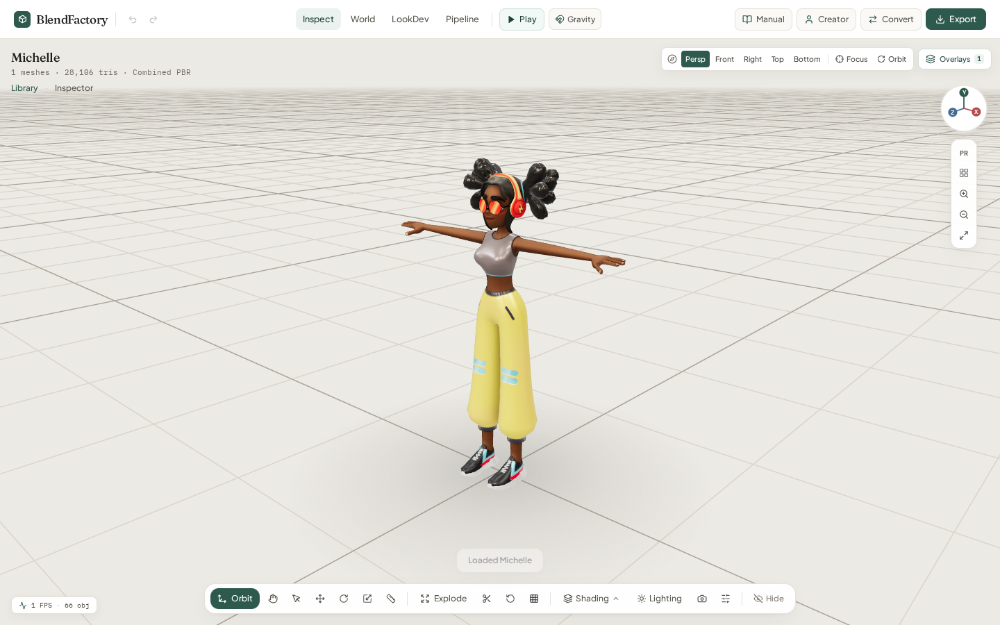
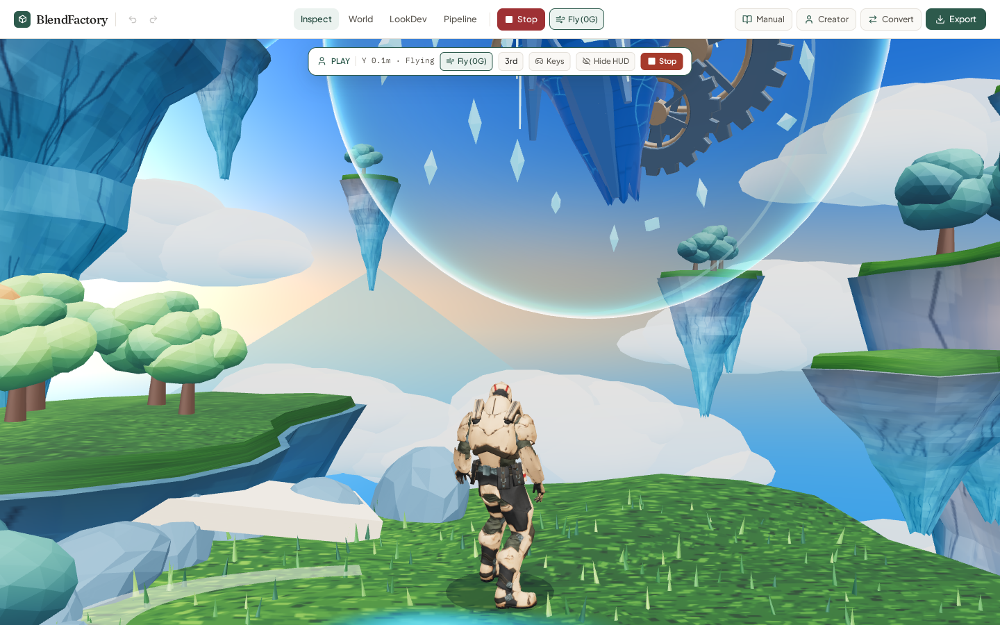
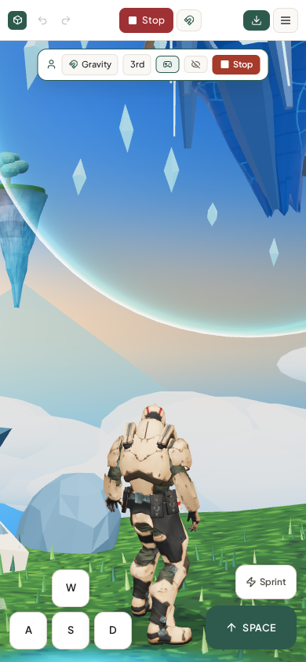

# BlendFactory Studio — Visual 3D World Studio & Inspection Medium

**BlendFactory Studio** is a visual 3D creation, open-world building, and play-testing studio combining the modeling precision of **Blender**, the component and Play Mode workflow of **Unity**, and the open-world scale of **Unreal Engine**.

It is engineered as a **visual 3D viewport and inspection medium** so both human creators and AI coding workflows (**Google AI Studio**, **Antigravity (AGY)**, CLI agents, and IDEs) can visually inspect, orbit (including below the grid at `Y < 0`), play-test, and iteratively refine procedural 3D models, materials, and open worlds stored cleanly in modular repository files.

---

## Visual Showcase

### Studio Overview — Multi-Angle Inspection & Categorized Model Library

*Warm-porcelain Atelier workspace featuring a fully scrollable, mobile-friendly **Model Library** organized by category (`Female Characters`, `Male Characters`, `Stylized & Rigged Characters`, `Architecture`, `Props`, `Environment`) with live visual model previews, one-click Multi-Angle Camera Presets, independent Viewport Overlays, Compact Telemetry HUD, Undo/Redo, Play/Stop, and 3-mode Gravity/Flight controls.*

### Temporary Unity/Unreal-Style Play Mode, Animated GLB Character & Mobile Controls

*Click **Play** in the top toolbar to spawn a rigged, animated 3D GLB player character (`Idle`/`Walk`/`Run` skeletal clips) with exact mesh-surface raycast grounding, coyote time, jump buffering, and 3-stage gravity cycling (**Normal `9.81 m/s²` → Low-G `3.5 m/s²` → Zero-G Sky Flight**). On mobile and touch devices (or whenever toggled via **Keys**), tactile on-screen `W/A/S/D`, `SPACE`, `Sprint`, and Zero-G `Down` controls pair with touch drag-to-look and a **Hide HUD** button.*

### Responsive Mobile & Tablet Workspace

*Zero-overlap responsive interface from compact `390×844` mobile displays to widescreen desktop monitors, featuring a full-height scrollable Model Library picker, collapsible `Views` / `Overlays` popovers, compact FPS telemetry chip, scrollable viewport dock, and one-tap **Hide HUD** mode.*

---

## Key Capabilities

### 1. Categorized Scrollable Model Library & Visual Inspection
- **Categorized Model Picker with Previews**: Browse repository and imported 3D assets grouped cleanly under `Female Characters`, `Male Characters`, `Stylized & Rigged Characters`, `Props`, `Architecture`, and `Environment` with studio preview thumbnails, instant search, sort controls, and effortless full-height scrolling on both desktop and small mobile displays.
- **Multi-Angle Camera Bar**: One-click `Persp`, `Front`, `Back`, `Left`, `Right`, `Top`, `Bottom` presets, `Focus (F)` selected framing, and `Orbit` turntable toggle (automatically collapsing into a compact `Views` popover on smaller screens), plus interactive 3D Axis Compass, Perspective/Orthographic (`Numpad 5`), and Quad View (`Alt+Ctrl+Q`).
- **Shading Passes & Overlays**: `Combined PBR`, `Albedo / Unlit`, `Wireframe`, `Normals`, `Roughness`, `Clay Matcap`, `X-Ray`, `UV Checker`, and `Point Cloud`, paired with independent `Grid`, `Axes`, `Bounds`, and `UCX Colliders` overlay toggles.
- **Compact Telemetry HUD**: Collapsible FPS chip expanding to live FPS, Object Count, Triangle/Vertex Count, Selected Bounding Dimensions (`W × H × D` meters), and Cursor/Selection `XYZ` coordinates.
- **Reliable Undo / Redo Stack**: Full command history (`Ctrl+Z` / `Ctrl+Y` / `Cmd+Shift+Z` and header buttons) tracking object creation, deletion, gizmo & numeric transforms, parent/child grouping, terrain sculpt/paint strokes, scatter brush strokes, and direct PBR material edits.
- **Theme-Consistent Menus**: Dedicated **Manual** modal (navigation, shortcuts, open-world tools, physics/Play Mode, and AI Studio/CLI workflow guide) and **Creator / About** modal.

### 2. Blender + Unity + Unreal Open-World Toolset
- **Unbounded 3D Space (`Y < 0` & Far Scale)**: Navigate, place objects, and sculpt terrain freely below `Y = 0` (caves, dungeons, undersides) and up to 600 m open-world radius.
- **Terrain Sculpt & Multi-Layer Paint**: Interactive brush modes (`Raise`, `Lower`, `Smooth`, `Flatten`, `Noise`) with adjustable radius & strength plus 6 vertex-painted ground layers (`Grass`, `Moss`, `Basalt`, `Sand`, `Snow`, `Cave Dirt`).
- **Modular Snapping & Scatter Brush**: Grid snapping (`0.1m`–`1.0m`), `15°` rotation snap, `0.25×` scale snap, Local/World gizmo space, Linear Array & Scatter modifiers, plus live brush-based procedural scattering (`Pine`, `Boulder`, `Crystal`, `Grass`, `Pillar`).
- **Direct PBR Material Editor**: Edit per-slot Albedo, Metallic, Roughness, Emissive color & glow, Bump scale, apply procedural PBR maps (`Stone`, `Wood`, `Bronze`, `Moss`), and extract/save textures directly to the repository.
- **Environment & Atmosphere**: Dynamic directional sun azimuth & pitch, real-time shadows toggle, 5 sky/environment presets (`Alabaster`, `Courtyard`, `Meadow`, `Desert`, `Celestial`), distance + height fog, and live Camera FOV & navigation speed sliders.
- **Enhanced Scene Outliner**: Search/filter bar, entity visibility (eye) and lock toggles, Solo isolation, Parent/Child `Group` & `Unparent`, `Clone`, `Delete`, and live numeric Position/Rotation/Scale editors.

### 3. Temporary Play Mode, Animated GLB Player & Refined Gravity / Flight Physics
- **Play / Stop Mode**: Click **Play** in the header (or Inspector → World) to drop a rigged animated GLB player character (`/public/models/player-character.glb`, MIT-licensed) onto the world with smooth `Idle`/`Walk`/`Run` animation blending, exact downward mesh-surface raycast grounding, coyote time, jump buffering, safe void-fall respawn (`Y < -20m`), and `V` camera switching (`3rd Person` / `1st Person`). Clicking **Stop** cleanly restores the pre-play scene snapshot.
- **3-Stage Gravity & Flight Mode**: Click the Gravity button in the header or Play Mode bar to cycle **Normal Gravity (`9.81 m/s²`) → Low-G Moon Jump (`3.5 m/s²`) → Zero-G Sky Flight (`Space` ascend / `C` descend)**, plus optional **Live Editor Rigid-Body Simulation**.
- **Mobile Touch Pad & Hide HUD**: Automatically activates on-screen `W/A/S/D`, `SPACE`, `Sprint`, and Zero-G `Down` keys on touch/mobile displays (toggleable via **Keys** on desktop) with a **Hide HUD** / **Show HUD** toggle for unobstructed full-screen exploration.

### 4. Visual Medium for AI Studio, Antigravity & CLI Workflows
All 3D assets, character models, manifests, and rendered previews live in clean, version-controlled repository directories:
```text
public/models/
  michelle.glb                     # Rigged SFW female character (Three.js MIT sample)
  player-character.glb             # Rigged SFW male tactical character (Three.js MIT sample)
  cesium-man.glb                   # Rigged SFW male explorer (Khronos CC-BY sample)
  xbot.glb                         # Rigged humanoid character (Three.js MIT sample)
  robot-expressive.glb             # Rigged expressive robot (Three.js CC0 sample)
  previews/*.png                   # Rendered studio previews for the Model Library picker
models/
  <slug>/manifest.json             # Canonical asset category & metadata index
src/utils/
  libraryCategories.ts             # Model Library category ordering, filtering & search
  terrainEngine.ts                 # Sculptable & paintable heightmap terrain engine
  physicsEngine.ts                 # Rigid-body gravity, colliders & Play Mode controller
  undoHistory.ts                   # Immutable command-history stack
```

AI tools and developers can edit procedural generators or `models/<slug>/build.py`, reload the running Studio viewport (`http://localhost:3000`), inspect every angle and `UCX_` collider visually, play-test scale and traversal, and iterate cleanly without any in-app chat clutter.

---

## Keyboard Shortcuts

| Shortcut | Action |
| :--- | :--- |
| `Ctrl+Z` / `Cmd+Z` | Undo last edit |
| `Ctrl+Y` / `Cmd+Shift+Z` | Redo |
| `G` / `R` / `S` | Translate / Rotate / Scale gizmo |
| `F` / `Numpad .` | Focus selected object |
| `Shift+D` | Duplicate selected node |
| `Delete` | Delete selected node |
| `Numpad 1 / 3 / 7` | Front / Right / Top view (`Ctrl+` for Back / Left / Bottom) |
| `Numpad 5` | Toggle Perspective / Orthographic |
| `Numpad 0` | Look through active Scene Camera (or Reset Frame) |
| `Alt+Ctrl+Q` | Toggle Quad View |
| `WASD` + `Q/E` | Free-fly editor navigation (or Player Move in Play Mode) |
| `Space` / `Shift` / `V` | Jump / Sprint / Toggle 3rd–1st Person Camera (Play Mode) |
| `H` | Toggle Zen mode (hide viewport HUD) |
| `Esc` | Exit Play Mode, brush mode, or Scene Camera view |

---

## Local Development & Verification

```bash
# 1. Install dependencies
npm install

# 2. Start the full-stack Vite + Express studio on http://localhost:3000
npm run dev

# 3. Run pure TypeScript unit tests (undo stack, terrain, physics, Play Mode, procedural scenes)
npx tsx --test src/utils/*.test.ts

# 4. Type-check & production build
npm run lint
npm run build
```

Optional environment variables (see `.env.example`) configure GitHub repository sync and headless Blender 4.2 LTS CI (`GITHUB_TOKEN`, `GITHUB_OWNER`, `GITHUB_REPO`, `GITHUB_BRANCH`). All 3D inspection, open-world building, terrain sculpting, physics, Play Mode, and 16-format export work completely locally out of the box.
